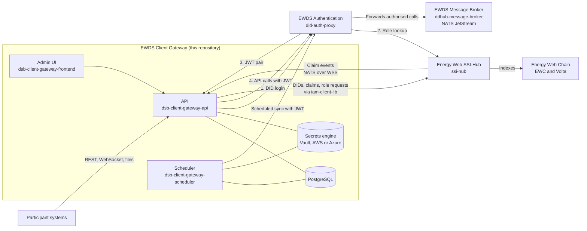
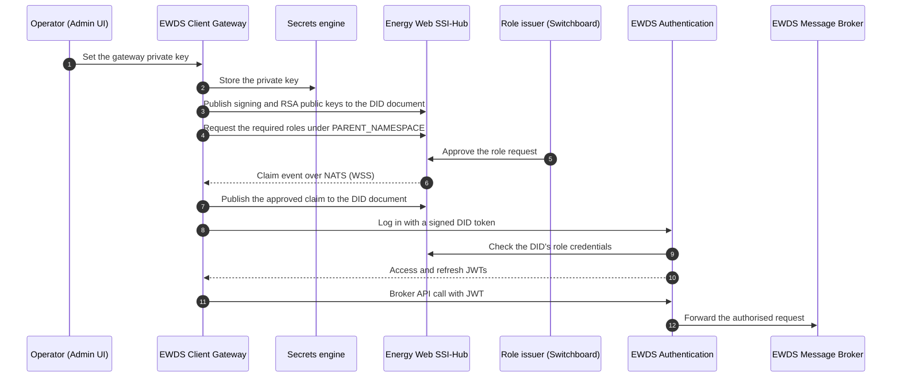
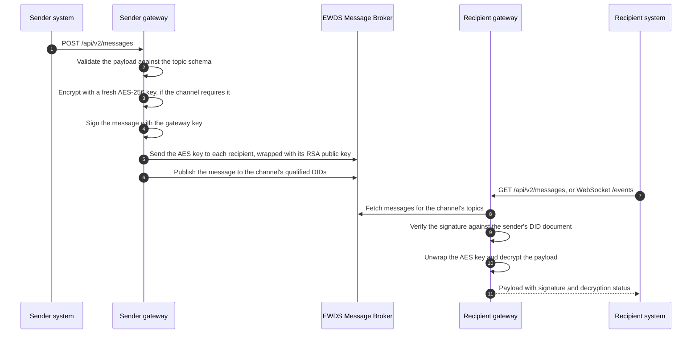
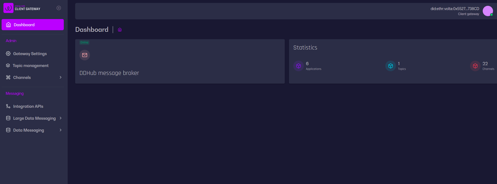

<p align="center">
  
</p>

<h1 align="center">EWDS Client Gateway</h1>

<p align="center">
  
  
  
  
  
  
</p>

<p align="center">
  <b>The participant-hosted gateway that connects an organisation once to the Energy Web Digital Spine, so it can exchange credential-governed data with every authorised counterparty.</b>
</p>

<p align="center">
  <code>ddhub-client-gateway</code> · Main EWDS repository · Public · Backend and frontend
</p>

---

## What This Is

The **Energy Web Digital Spine (EWDS)** is Energy Web's decentralised, credential-governed and privacy-preserving data exchange for multi-party markets. It provides an event-driven communication backbone through which each participating organisation (a *participant*) exchanges data securely and interoperably with its counterparts. Instead of maintaining point-to-point integrations, each participant connects once and reaches every authorised counterparty. No central authority holds or controls all business-critical data: each participant manages and takes responsibility for the data it sends and receives, so there is no single point of risk or failure.

The **EWDS Client Gateway (EWDS CGW)** is the component each participant runs to join EWDS. It is a participant-hosted set of containers that keeps the participant in control of its own data, credentials and keys while connecting it to the shared exchange. Participants use it to:

- **Configure** payload schemas (topics) and messaging channels.
- **Send and receive** data, integrating their own systems through REST, WebSocket or file transfer APIs.
- **Manage identity**: the gateway's DID, its role enrolments, and the encryption and signing keys derived from its private key.

The gateway manages its DID with the Energy Web SSI-Hub Client Library (`iam-client-lib`), authenticates to the EWDS Message Broker with that DID through EWDS Authentication (`did-auth-proxy`), and receives credential events from the Energy Web SSI-Hub over NATS on a secure WebSocket.

> **On naming.** The code still carries the product's earlier names, DDHub and DSB. Application projects are called `dsb-client-gateway-*`, most libraries are called `ddhub-client-gateway-*`, and some environment variables keep the `DSB_` prefix (for example `DSB_BASE_URL`, the message broker URL). This README uses the EWDS names for components and the code names for anything you type.

## Where It Fits In EWDS



The gateway never calls the message broker directly. Every broker call passes through EWDS Authentication, which checks the caller's DID and role credentials. Access to topics and channels is therefore governed by cryptographically provable roles rather than by a central user directory.

### The Components Around The Gateway

| Component | Repository | What it does for the gateway |
|-----------|------------|------------------------------|
| **EWDS Message Broker** | [`ddhub-message-broker`](https://github.com/energywebfoundation/ddhub-message-broker) | The shared NATS JetStream backbone. It holds topics, routes messages and files between gateways, and delivers each message only to participants holding the required role credentials. It does not process the payloads it carries and keeps them only as long as needed for at-least-once delivery (24 hours by default). |
| **EWDS Authentication** | [`did-auth-proxy`](https://github.com/energywebfoundation/did-auth-proxy) | An Nginx-based gateway in front of the broker. It exchanges the gateway's signed DID token for a pair of JWTs, then validates the token on every call before forwarding it. |
| **Energy Web SSI-Hub** | [`ssi-hub`](https://github.com/energywebfoundation/ssi-hub) | The identity backend. It indexes DID documents and the ENS namespaces for organisations, applications and roles, brokers role requests and approvals, and publishes claim events over NATS. |
| **SSI-Hub Client Library** | [`iam-client-lib`](https://github.com/energywebfoundation/iam-client-lib) | The JavaScript SDK the gateway uses to manage its DID, sign its login token, read claims and request roles. |
| **SSI-Hub DID Authentication Library** | [`passport-did-auth`](https://github.com/energywebfoundation/passport-did-auth) | The Passport.js strategy that EWDS Authentication uses to verify the gateway's DID login. |
| **SSI-Hub Switchboard** | [`switchboard-dapp`](https://github.com/energywebfoundation/switchboard-dapp) | The web interface where organisations govern their namespaces, applications and roles, and where issuers approve role requests, including the gateway's. |
| **Energy Web Credentials** and **DID Registry** | [`ew-credentials`](https://github.com/energywebfoundation/ew-credentials), [`ew-did-registry`](https://github.com/energywebfoundation/ew-did-registry) | Core libraries and smart contracts for DIDs, claims, revocation and credential verification. |
| **Energy Web Chain** | Not a repository | EWC mainnet and the Volta testnet, where the ENS registry and identity contracts are deployed and indexed by the SSI-Hub. |

## How The Gateway Joins EWDS

A gateway becomes a participant through its DID. The private key lives in the participant's secrets engine, the public keys are published to the DID document, and roles are requested and approved through the SSI-Hub before the gateway can log in to the broker.



Each role moves through the statuses `NOT_ENROLLED`, `AWAITING_APPROVAL`, `APPROVED` (or `REJECTED`) and `SYNCED`. The gateway is ready to exchange data once every required role is `SYNCED`.

## How Data Moves



For clarity the diagram leaves out EWDS Authentication, which sits in front of every broker call.

Each channel has one of four types, which fixes its direction and its interface:

| Channel type | Direction | Interface (prefix `/api/v2`) |
|--------------|-----------|------------------------------|
| `pub` | Send messages | `POST /messages` |
| `sub` | Receive messages | `GET /messages`, `POST /messages/ack`, or the WebSocket at `/events` |
| `upload` | Send files | `POST /messages/upload` |
| `download` | Receive files | `GET /messages/download` |

Topic schemas can be JSON Schema (`JSD7`), XML Schema (`XSD6`), `XML`, `CSV` or `TSV`. Files are limited by `MAX_FILE_SIZE` (100 MB by default).

## Core Concepts

| Concept | What it is |
|---------|------------|
| **Identity** | The gateway's DID, derived from its private key. On start-up the gateway derives an RSA-4096 key pair from that key and makes sure its public RSA and signing keys are on its DID document. |
| **Enrolment** | The roles the gateway needs under `PARENT_NAMESPACE`, and their approval status. |
| **Application** | An SSI-Hub application namespace that owns topics. The visible namespaces are filtered by `APPLICATION_NAMESPACE_REGULAR_EXPRESSION`. |
| **Topic** | A versioned payload schema owned by an application and stored on the broker. |
| **Channel** | A gateway-local configuration identified by its fully qualified channel name (FQCN). It sets the channel type, the topics it carries, the conditions (roles and DIDs) that define its counterparties, and whether payloads are encrypted. |
| **Qualified DIDs** | The counterparties a channel resolves to. The scheduler regularly turns each channel's role conditions into a list of DIDs. |
| **Client ID** | A named consumer used when fetching messages or opening a WebSocket connection. Client IDs expire after `CLIENT_EXPIRATION_DAYS` (30 by default). |
| **Address book** | Local labels for counterpart DIDs. |
| **Users and API keys** | With `USER_AUTH_ENABLED=true`, the API, the WebSocket and the Admin UI require authentication. Users carry the role `admin`, `superadmin` or `messaging`, and integrations can use API keys. |

## The Three Applications

| Application | Nx project | Built with | What it does |
|-------------|------------|------------|--------------|
| **API** | `dsb-client-gateway-api` | NestJS 11 | Serves the REST API under `/api/v2`, the WebSocket at `/events` and the Swagger UI at `/docs`. It talks to the broker, the SSI-Hub and the secrets engine. Default port 3333. |
| **Admin UI** | `dsb-client-gateway-frontend` | Next.js 15, React 18, MUI 5 | The operator interface for configuring the gateway and its access. It is built as a static export, served by nginx in production, and calls the API through a typed client generated with Orval. |
| **Scheduler** | `dsb-client-gateway-scheduler` | NestJS 11 | Runs the background jobs that refresh caches and clean up local data. |

### Scheduler Jobs

Every job can be switched on or off and rescheduled through environment variables (see [docs/scheduler-variables.md](docs/scheduler-variables.md)). Job results are exposed at `GET /api/v2/cron`.

| Job | Default schedule | Work |
|-----|------------------|------|
| Topics | `*/1 * * * *` | Refresh topics and schema versions from the broker |
| Applications | `*/1 * * * *` | Refresh the application namespaces the gateway can use |
| Channel DIDs | `*/1 * * * *` | Resolve each channel's role conditions into qualified DIDs |
| Symmetric keys | `*/1 * * * *` | Fetch the AES keys other gateways have sent to this one |
| Roles refresh | `*/1 * * * *` | Detect changes to the gateway's DID roles |
| Private key | `*/11 * * * *` | Detect a private key change in the secrets engine |
| Clients | `*/5 * * * *` | Remove expired client IDs |
| Message cleaner | `*/30 * * * *` | Clean up local message data |
| File cleaner | `*/1 * * * *` | Delete expired uploaded and downloaded files (30 minutes by default) |
| Association keys | `*/1 * * * *` (off by default) | Generate association keys |
| Heartbeat | `30 * * * * *` | Record that the scheduler is alive |
| DID listener | Event driven | Listen for DID attribute changes on the DID registry |

## Integration Interfaces

### REST

All routes are under `/api/v2`. The full, authoritative reference is the Swagger UI at `{API_HOST}/docs`, and the OpenAPI document at `{API_HOST}/docs-json` can be imported into Postman.

```
Messaging       /messages, /messages/ack, /messages/upload, /messages/download,
                /messages/sent, /messages/received
Configuration   /channels, /topics, /applications, /contacts
Identity        /identity, /enrol, /ssi-hub, /keys, /certificate
Operations      /gateway, /clients, /cron, /health
Access          /login, /user-api-key
```

### WebSocket

Set `WEBSOCKET` to choose how messages are pushed to your systems:

| Mode | Behaviour |
|------|-----------|
| `NONE` | No WebSocket. Fetch messages over REST. This is the default. |
| `SERVER` | The API accepts connections at `ws(s)://{API_HOST}/events?clientId={id}` with the subprotocol `ddhub-protocol`. |
| `CLIENT` | The gateway connects out to `WEBSOCKET_URL` and pushes messages there, reconnecting as configured. |

`EVENTS_EMIT_MODE` (`SINGLE` or `BULK`) and `EVENTS_MAX_PER_SECOND` control how messages are emitted.

### File Transfer

Files are sent on `upload` channels and received on `download` channels. Uploaded and downloaded files are stored temporarily in `UPLOAD_FILES_DIR` and `DOWNLOAD_FILES_DIR` and removed by the scheduler when their lifetime ends.

## Security Model

- **Keys stay with the participant.** The gateway private key, user records and the mTLS client certificate are kept in the participant's own secrets engine: HashiCorp Vault, AWS Secrets Manager or Azure Key Vault, chosen with `SECRETS_ENGINE`.
- **No passwords or shared keys towards the broker.** The gateway logs in with a signed DID token and uses short-lived JWTs, which it refreshes automatically.
- **End-to-end payload encryption, per channel.** Each message gets a fresh AES-256-CBC key. That key is encrypted for each recipient with RSA-OAEP, using the RSA public key on the recipient's DID document. The broker never sees the plaintext of an encrypted channel.
- **Every message is signed.** The gateway signs each message with its secp256k1 key. Recipients recover the signer's public key, compare it with the signing key on the sender's DID document, and report the result as `signatureValid`.
- **Counterparties are defined by credentials.** A channel's recipients are the DIDs that hold the roles in its conditions, so access follows role credentials rather than manual allow-lists.
- **mTLS to the broker.** With `MTLS_ENABLED=true` (the default), outbound broker calls use the client certificate uploaded through `/certificate`.
- **Local access control.** With `USER_AUTH_ENABLED=true`, users, roles and API keys guard HTTP, WebSocket and Admin UI access.

## Admin UI



The Admin UI is where operators set up and run the gateway. Its sections cover the dashboard, gateway settings and identity, roles, applications and topics, channels, messages and files, the address book, client IDs, API keys, users and integration.

## Tech Stack

| Layer | Choice |
|-------|--------|
| Monorepo | Nx 13 workspace with pnpm 11 workspaces |
| Runtime | Node.js 22 (22.21.1 pinned in `.nvmrc` and CI) |
| API and Scheduler | NestJS 11, CQRS, `@nestjs/schedule`, `ws` WebSocket adapter, Joi-validated configuration |
| Admin UI | Next.js 15 (static export), React 18, MUI 5, React Query, React Hook Form, Monaco editor, Orval-generated API client |
| Database | PostgreSQL 14 through TypeORM 0.3 |
| Identity | `iam-client-lib`, `ew-did-registry` packages, ethers 5 |
| Events | `nats.ws` for SSI-Hub claim events |
| Secrets | HashiCorp Vault, AWS Secrets Manager, Azure Key Vault |
| Observability | OpenTelemetry (OTLP), pino logs, Sentry in the Admin UI |
| Testing | Jest, jest-cucumber Gherkin features (API end-to-end), Cypress (Admin UI end-to-end) |

## Repository Layout

```
apps/
  dsb-client-gateway-api/              NestJS API: REST, WebSocket, Swagger
  dsb-client-gateway-scheduler/        NestJS scheduler: cache refresh and clean-up jobs
  dsb-client-gateway-frontend/         Next.js Admin UI
  dsb-client-gateway-api-e2e/          Gherkin end-to-end tests for the API (jest-cucumber)
  dsb-client-gateway-frontend-e2e/     Cypress project for the Admin UI
libs/
  ddhub-client-gateway-message-broker/ EWDS Message Broker client (login, topics, messages, files)
  ddhub-client-gateway-did-auth/       DID login and token refresh against EWDS Authentication
  dsb-client-gateway-iam-client/       wrapper around iam-client-lib
  ddhub-client-gateway-enrolment/      role enrolment and the NATS claim listener
  ddhub-client-gateway-encryption/     symmetric key cache
  dsb-client-gateway-secrets-engine/   Vault, AWS Secrets Manager and Azure Key Vault engines
  dsb-client-gateway-storage/          TypeORM entities and repositories
  dsb-client-gateway-did-registry/     DID registry contract bindings and listener
  ddhub-client-gateway-tls-agent/      mTLS agent for outbound calls
  ddhub-client-gateway-user-roles/     local user roles and guards
  ddhub-client-gateway-tracing/        OpenTelemetry set-up
  ddhub-client-gateway-env/            Joi schemas for environment variables
  dsb-client-gateway-api-client/       Orval-generated API client used by the Admin UI
  ddhub-client-gateway-frontend/       Admin UI feature libraries (channels, topics, messaging, and more)
  ...                                  address book, association keys, clients, clean-up, events,
                                       errors, guard, identity, utils, version
migrations/                            TypeORM migrations (compiled to migrations-build/ before running)
ci/                                    Dockerfiles for the API, scheduler and Admin UI, and a CI compose file
get-started/                           Docker Compose files that run the published images
docs/                                  environment variable reference and images
cypress/                               Cypress specs and per-environment identities
scripts/                               end-to-end and test-migration helpers
patches/                               pnpm patches for upstream dependencies
```

## Quick Start

### Prerequisites

- Node.js 22.21.1 (`nvm use` reads `.nvmrc`) and pnpm 11
- Docker with Docker Compose
- A private key for the gateway's DID, and the EWDS endpoints for your target environment (message broker, SSI-Hub, NATS event server and RPC)

### Run The Published Images

The [`get-started`](get-started) folder runs the API, scheduler, Admin UI, migrations, PostgreSQL and an nginx proxy from the published images. On this branch the compose files pull the `intelligent-canary` images.

```bash
cd get-started

# Point .ewc-env at your target environment (broker, RPC, SSI-Hub, NATS, database, namespace).
# Export the secrets engine variables that docker-compose.yml passes through
# (SECRETS_ENGINE plus the AWS_* or AZURE_* variables).

docker compose up -d
# Admin UI and API through the proxy: http://localhost:3009
```

To run a self-hosted Vault alongside the gateway instead, use `docker compose -f docker-compose.vault.yml up -d`, which initialises and unseals the Vault and enables the `ddhub` KV mount.

### Local Development

```bash
nvm use
pnpm install --frozen-lockfile

# PostgreSQL, a dev Vault, and tracing (Jaeger, Zipkin, OpenTelemetry collector)
docker compose up -d

# Optional: enable the ddhub KV mount in the dev Vault and create sample users
./vault-prepare.sh

# Create .env (see Configuration), then run the database migrations
pnpm migrations:build
pnpm migrations:run

# Generate the typed API client the Admin UI depends on
pnpm build:client

pnpm nx serve dsb-client-gateway-api         # http://localhost:3333/api/v2
pnpm nx serve dsb-client-gateway-scheduler
pnpm nx serve dsb-client-gateway-frontend    # http://localhost:4200
```

`pnpm start:dev` starts the API and the Admin UI together.

### Production Build

```bash
pnpm install --frozen-lockfile

pnpm nx build dsb-client-gateway-api
pnpm nx build dsb-client-gateway-scheduler
pnpm run export    # static Admin UI in dist/apps/dsb-client-gateway-frontend/exported

pnpm migrations:build
pnpm migrations:run

node dist/apps/dsb-client-gateway-api/main.js
node dist/apps/dsb-client-gateway-scheduler/main.js
```

Running plain `node` in production is not recommended. Use a process manager or containers. Dockerfiles for each application are in [`ci/Docker`](ci/Docker), and Helm charts are in [`dsb-client-gateway-helm`](https://github.com/energywebfoundation/dsb-client-gateway-helm).

## Configuration

Each application reads its configuration from environment variables (a `.env` file in development), validated at start-up against Joi schemas. The full reference, generated from those schemas, is:

| Application | Reference |
|-------------|-----------|
| API | [docs/api-variables.md](docs/api-variables.md) |
| Scheduler | [docs/scheduler-variables.md](docs/scheduler-variables.md) |
| Admin UI | [docs/frontend-variables.md](docs/frontend-variables.md) |

The variables most deployments set first:

| Variable | Purpose |
|----------|---------|
| `DB_NAME` | PostgreSQL connection string (also used by the migrations) |
| `DSB_BASE_URL` | EWDS Message Broker URL |
| `RPC_URL`, `CHAIN_ID`, `CHAIN_NAME` | Energy Web Chain network the DID lives on |
| `CACHE_SERVER_URL` | Energy Web SSI-Hub URL |
| `EVENT_SERVER_URL`, `NATS_ENV_NAME` | NATS server for SSI-Hub claim events |
| `PARENT_NAMESPACE` | Namespace under which the gateway's roles are requested |
| `SECRETS_ENGINE` | `vault`, `aws` or `azure`, plus that engine's own variables |
| `MTLS_ENABLED` | Use a client certificate for broker calls |
| `WEBSOCKET` | `NONE`, `SERVER` or `CLIENT` |
| `USER_AUTH_ENABLED` | Require user login and API keys |
| `OPENTELEMETRY_ENABLED` | Export traces over OTLP |
| `NEXT_PUBLIC_SERVER_BASE_URL` | API URL the Admin UI calls |

Several defaults point at Energy Web development services and the Volta testnet, so review every value for your target environment. After changing a schema, run `pnpm generate:envs` to regenerate the API and scheduler references.

## Testing

| Suite | Command |
|-------|---------|
| Unit tests for one project | `pnpm nx test dsb-client-gateway-api` (or any other project) |
| Unit tests affected by a change | `pnpm nx affected --target=test` |
| Database migrations | `pnpm migrations:test:run` |
| API end-to-end (Gherkin features) | `pnpm test:e2e:api:prepare`, then `pnpm test:e2e:api` |
| Admin UI end-to-end (Cypress) | Set the `CYPRESS_*` variables listed in `cypress.config.ts`, add `cypress/fixtures/{CYPRESS_TARGET_ENV}/identity.json`, then `pnpm exec cypress run` |

`test:e2e:api:prepare` starts PostgreSQL and Vault from `ci/docker-compose.yml`, creates the `ddhub_test` database and runs the migrations against it.

## Branches And Releases

| Branch | CI |
|--------|----|
| `develop` | Default target for pull requests. Lint, commit lint and affected tests run on every pull request. |
| `master`, `pre_release` | Releases and pre-releases. Semantic versioning, then the images are built and published. |
| `develop-intelligent` | Publishes the `ddhub-client-gateway-backend`, `-frontend` and `-scheduler` images tagged `intelligent-canary` and `intelligent-{id}`. |

Commits follow [Conventional Commits](https://www.conventionalcommits.org/), enforced by commitlint through Husky. `pnpm run commit` opens an interactive prompt that builds a valid message.

## Documentation

| Document | Covers |
|----------|--------|
| [docs/api-variables.md](docs/api-variables.md) | API environment variables |
| [docs/scheduler-variables.md](docs/scheduler-variables.md) | Scheduler environment variables |
| [docs/frontend-variables.md](docs/frontend-variables.md) | Admin UI environment variables |
| `{API_HOST}/docs` | Swagger UI for the REST API |
| `{API_HOST}/docs-json` | OpenAPI document, importable into Postman |
| [get-started](get-started) | Docker Compose set-ups that run the published images |

## What This Is Not

- **Not the message broker.** The gateway does not route data between participants. The EWDS Message Broker does, and the gateway reaches it only through EWDS Authentication.
- **Not an identity governance tool.** Organisations, applications and role definitions are governed in the Energy Web SSI-Hub Switchboard. The gateway requests and uses roles; it does not define them.
- **Not a central service.** Each participant runs and operates its own gateway, keys, secrets engine and database, and takes responsibility for the data it sends and receives.
- **Not a data archive.** The broker keeps payloads only as long as needed for delivery, and the gateway cleans up its local message and file data on a schedule. Participants keep their records in their own systems.

## Contributing

Pull requests are welcome. Branch from `develop` and target `develop` with your pull request. For major changes, please open an issue first to discuss what you would like to change. Please add or update tests with your change, and use Conventional Commits for your commit messages.

## Licence

Owned by Energy Web AG. Licensed under the GNU General Public License v3.0. See [LICENSE](LICENSE).
